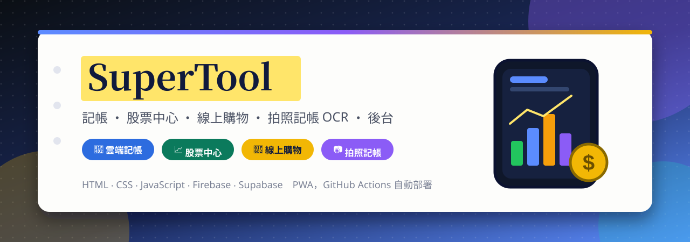
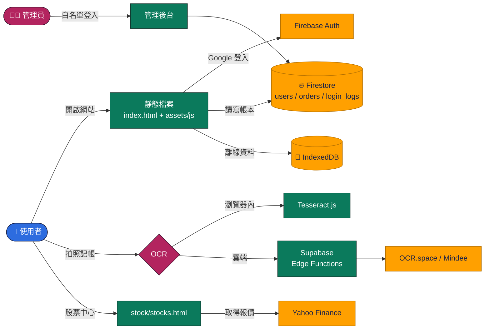

<a id="top"></a>

<div align="center">



<br>

[](https://github.com/Jiachang1112/Website-Development)
[](https://jiachang1112.github.io/Website-Development/)
[](https://github.com/Jiachang1112)

[](https://developer.mozilla.org/docs/Web/HTML)
[](https://developer.mozilla.org/docs/Web/CSS)
[](https://developer.mozilla.org/docs/Web/JavaScript/Guide/Modules)
[](https://firebase.google.com/)
[](https://firebase.google.com/docs/firestore)
[](https://supabase.com/docs/guides/functions)
[](https://www.chartjs.org/)
[](https://tesseract.projectnaptha.com/)
[](https://web.dev/progressive-web-apps/)
[](https://github.com/features/actions)
[](https://pages.github.com/)

**記帳 ‧ 股票中心 ‧ 線上購物 ‧ 拍照記帳 OCR ‧ 管理後台 ‧ 可安裝的 PWA**

<br>

[](#-快速開始)
[](#-頁面一覽)
[](#-設定你自己的服務)
[](#-拍照記帳與-ocr)
[](#-部署)
[](#-注意事項)
[](#-常見問題)

</div>

---

## ✨ 特色

<table>
<tr>
<td width="33%" valign="top">

### 📒 雲端記帳
支出、收入、多本帳本，資料存在 Firestore。有統計圖表、分析頁，還有連續記帳天數（Streak）。

</td>
<td width="33%" valign="top">

### 💬 聊天記帳
像聊天一樣輸入「今天 全聯 牛奶 65 餐飲」或「昨天 領薪水 25000」就能記一筆，不用填一堆欄位。

</td>
<td width="33%" valign="top">

### 📷 拍照記帳
拍下發票或收據，用 OCR 辨識金額與品項。可以在瀏覽器內辨識，也可以走 Supabase 的雲端 OCR。

</td>
</tr>
<tr>
<td valign="top">

### 📈 股票中心 Pro+
自選股、價格提醒、條件篩選、走勢圖與新聞。支援美股與台股代碼（例如 `AAPL`、`2330.TW`）。

</td>
<td valign="top">

### 🛒 線上購物
商品列表、購物車、宅配或超商取貨、多種付款方式，目前是**示範流程**。

</td>
<td valign="top">

### 🛡️ 管理後台
管理員白名單、用戶登入紀錄、訂單管理與記帳設定。

</td>
</tr>
</table>

### 📲 可安裝的 PWA

有 `manifest.json` 與 `service-worker.js`，手機和電腦的瀏覽器都能「加到主畫面」，用起來像獨立 App。

---

## 🗂️ 頁面一覽

主程式 `index.html` 是單頁應用，用網址的 `#` 切換頁面，另外還有幾個獨立頁面。

| 頁面 | 網址 | 內容 |
| --- | --- | --- |
| 🏠 首頁 | `index.html#dashboard` | 功能介紹頁 |
| 🔐 帳號 | `#auth` | Google 登入 |
| 💸 支出 | `#expense` | 新增支出 |
| 💰 收入 | `#income` | 新增收入 |
| 💬 聊天記帳 | `#chatbook` | 用一句話記帳 |
| 📷 拍照記帳 | `#camera` | 拍照辨識發票 |
| 📊 統計 | `#chart` | 支出統計圖 |
| 🔎 我的／明細／分析 | `#acct_mine`、`#acct_detail`、`#acct_analysis` | 記帳設定、明細、分析 |
| 🛒 購物 | `#shop` | 商品列表 |
| 💾 備份 | `#backup` | 匯出／匯入 JSON 備份 |
| ⚙️ 設定 | `#settings` | 個人設定 |
| 🛡️ 後台 | `#admin` | 管理員入口 |
| 📒 記帳 | `book.html` | 獨立的記帳頁 |
| 📈 股票 | `stock/stocks.html` | 股票中心 Pro+ |
| 🧺 下單 Demo | `cart-demo.html` | 購物車與結帳示範 |
| 💳 結帳 | `payment.html` | 升級方案與付款（模擬） |
| 🧾 記帳設定 | `admin/accounting-settings.html` | 帳本與分類設定 |
| 👥 用戶登入紀錄 | `admin/user-login.html` | 管理員查看登入紀錄 |

---

## 🧩 運作方式



- 網站是**純靜態檔案**，沒有自己的伺服器，部署時不需要 build。
- 帳本資料放在 Firestore：`users/{uid}/ledgers/{ledgerId}/entries`，另外有 `orders`（訂單）與 `login_logs`（登入紀錄）。
- 發票辨識有兩條路：用 **Tesseract.js** 在瀏覽器裡辨識，或呼叫 **Supabase Edge Functions**，由它轉送到 OCR.space 或 Mindee。API 金鑰放在 Supabase 的環境變數，不在前端。
- 股票報價來自 Yahoo Finance 的公開介面，透過公開的 CORS 代理取得。

### 📁 檔案說明

```text
Website-Development/
├── index.html                    主程式入口（單頁應用）
├── book.html                     獨立的記帳頁
├── cart-demo.html                購物車與下單示範
├── payment.html                  升級方案與結帳（模擬付款）
├── manifest.json                 PWA 設定
├── service-worker.js             PWA 離線快取
├── data/products.json            示範商品資料
├── .github/workflows/pages.yml   推送到 main 時自動部署 GitHub Pages
├── admin/
│   ├── accounting-settings.html  記帳設定
│   └── user-login.html           用戶登入紀錄
├── stock/
│   ├── stocks.html               股票中心 Pro+
│   └── stocks.js
├── supabase/functions/
│   ├── ocr-receipt/              OCR.space 發票辨識
│   └── mindee-receipt/           Mindee 發票辨識
└── assets/
    ├── css/style.css             樣式
    ├── img/                      圖示與標誌
    ├── readme/                   本 README 用的橫幅
    └── js/
        ├── app.js                路由與主流程
        ├── config.js             Google Client ID、管理員、OCR 設定
        ├── firebase.js           Firebase 初始化
        ├── auth-utils.js         登入相關工具
        ├── db.js / cloud.js      IndexedDB 與雲端存取
        ├── entries.js            帳目資料處理
        ├── ocr.js                Tesseract.js 載入與辨識
        ├── analytics/            登入紀錄、連續記帳
        └── pages/                各頁面（支出、收入、統計、後台……）
```

---

## ⚡ 快速開始

**1. 下載專案**

```bash
git clone https://github.com/Jiachang1112/Website-Development.git
cd Website-Development
```

**2. 啟動本機伺服器**（任何靜態伺服器都可以）

```bash
python3 -m http.server 8000
# 或：npx serve .
```

**3. 打開瀏覽器**

| 想看什麼 | 網址 |
| --- | --- |
| 🏠 首頁 | http://localhost:8000/ |
| 📒 記帳頁 | http://localhost:8000/book.html |
| 📈 股票中心 | http://localhost:8000/stock/stocks.html |
| 🧺 下單 Demo | http://localhost:8000/cart-demo.html |

> ⚠️ 專案使用 ES Modules，不能直接雙擊 `index.html` 開啟，一定要透過 `http://` 載入。

登入、記帳、後台這些功能需要連到 Firebase，請繼續看下一節。

---

## 🔥 設定你自己的服務

專案預設連到作者自己的 Firebase 與 Supabase。如果你是 fork 或複製來用，**請換成你自己的專案**。

<details open>
<summary><b>① Firebase（登入與資料庫）</b></summary>

1. 到 [Firebase 主控台](https://console.firebase.google.com/) 建立專案，開啟 **Authentication** 與 **Firestore Database**。
2. 專案設定 → 新增網頁應用程式，複製 `firebaseConfig`。
3. 打開 `assets/js/firebase.js`，把 `firebaseConfig` 換成你的。
4. Authentication → Settings → **已授權網域**，加入你的網域（`localhost` 預設已經有）。
5. 到 Firestore 的「規則」設定好存取權限：使用者只能讀寫自己的 `users/{uid}`，管理員才能讀 `orders`、`login_logs`。

> 💡 網頁用的 `apiKey` 不是機密，真正保護資料的是 Firestore 規則。

</details>

<details open>
<summary><b>② Google 登入與管理員</b></summary>

1. 到 [Google Cloud Console](https://console.cloud.google.com/apis/credentials) 建立 **OAuth 用戶端 ID**（網頁應用程式），把網站網址加進授權的 JavaScript 來源。
2. 打開 `assets/js/config.js`，把 `GOOGLE_CLIENT_ID` 換成你的。
3. 管理員信箱（**一律小寫**）目前寫在這幾個檔案裡，請一併改成你的：
   `assets/js/config.js`、`assets/js/firebase.js`、`assets/js/pages/auth.js`、`assets/js/pages/admin.js`、`assets/js/pages/admin-userlog.js`、`assets/js/auth-utils.js`

> 管理員判斷寫在前端，只能控制畫面。真正的權限要靠 Firestore 規則把關。

</details>

<details open>
<summary><b>③ 聯絡表單（Formspree）</b></summary>

`index.html` 裡的聯絡表單送到 Formspree。到 [Formspree](https://formspree.io/) 建立自己的表單，把 `<form id="contactForm" action="...">` 的網址換掉。

</details>

---

## 📷 拍照記帳與 OCR

| 方式 | 說明 | 需要設定 |
| --- | --- | --- |
| 🌐 瀏覽器內辨識 | 用 Tesseract.js，圖片不會離開你的裝置 | 不用，會自動載入 |
| ☁️ 雲端辨識 | 呼叫 Supabase Edge Function，再轉給 OCR.space 或 Mindee | 需要 Supabase 專案與 API 金鑰 |

**設定雲端辨識：**

1. 到 [Supabase](https://supabase.com/) 建立專案，安裝 [Supabase CLI](https://supabase.com/docs/guides/cli)。
2. 設定金鑰（不要寫進程式碼）：

```bash
supabase secrets set OCRSPACE_API_KEY=你的金鑰
supabase secrets set MINDEE_API_KEY=你的金鑰
```

3. 部署函式：

```bash
supabase functions deploy ocr-receipt
supabase functions deploy mindee-receipt
```

4. 打開 `assets/js/config.js`，把 `SUPABASE_URL` 換成你部署後的函式網址，`OCR_DEFAULT_LANG` 可選 `eng`、`chi_sim`、`chi_tra`。

---

## 📦 部署

專案已附 GitHub Actions 設定檔，**推送到 `main` 就會自動部署**。

1. 專案 Settings → Pages → **Source** 選 **GitHub Actions**。
2. 推送程式碼到 `main`，到 Actions 頁籤看部署進度。
3. 完成後網址是 `https://jiachang1112.github.io/Website-Development/`。
4. 回到 Firebase → Authentication → 已授權網域，加入 `jiachang1112.github.io`，否則登入會失敗。

也可以用 Cloudflare Pages、Vercel 等任何靜態主機，Build command 留空、輸出目錄用專案根目錄即可。

---

## ⚠️ 注意事項

- **付款是模擬的**：`payment.html` 按下付款只會顯示成功動畫，不會連到任何金流，也不會傳送卡號。請不要在裡面輸入真實的信用卡資料。要收款請改接綠界、藍新等金流。
- **股票資料不是官方來源**：股票中心透過 Yahoo Finance 的非官方介面與公開 CORS 代理取得報價，穩定性無法保證，也不適合當作交易依據。
- **子路徑部署**：`service-worker.js` 與 `manifest.json` 用 `/` 開頭的路徑。網站若不是放在網域根目錄（例如 GitHub Pages 的 `/Website-Development/`），這些路徑會對不到檔案，離線快取不會生效。
- **管理員判斷在前端**：請務必設定好 Firestore 規則。

---

## ❓ 常見問題

<details>
<summary><b>開啟後畫面空白，或按了沒反應</b></summary>

1. 確認是用 `http://localhost:8000/` 開的，不是直接雙擊檔案。
2. 打開瀏覽器的開發者工具（F12）看 Console 有沒有錯誤。
3. 專案要連到外部網路載入 Firebase 與圖表等套件，請確認網路正常。

</details>

<details>
<summary><b>Google 登入失敗，或說網域未授權</b></summary>

1. Firebase → Authentication → Settings → 已授權網域，加入你的網域。
2. Google Cloud Console 的 OAuth 用戶端 ID，要把網站網址加進「已授權的 JavaScript 來源」。
3. 確認 `assets/js/config.js` 的 `GOOGLE_CLIENT_ID` 已經換成真的值，不是範例的 `YOUR_GOOGLE_CLIENT_ID`。

</details>

<details>
<summary><b>拍照記帳辨識不出金額</b></summary>

1. 照片請盡量清楚、拍正、光線充足。
2. 語言要和發票一致，繁體中文選 `chi_tra`。
3. 如果用雲端辨識，確認 Supabase 函式已部署，金鑰已用 `supabase secrets set` 設定。

</details>

<details>
<summary><b>股票中心載入不出報價</b></summary>

股票資料來自非官方介面與公開代理，偶爾會被限流或失效。稍後重試，或換個時間再看。

</details>

<details>
<summary><b>換了裝置，資料不見了</b></summary>

登入後的帳本存在 Firestore，換裝置登入同一個 Google 帳號就會同步。沒登入時存在瀏覽器裡的資料（IndexedDB、`localStorage`）不會跨裝置，請先到「備份」頁匯出。

</details>

---

<div align="center">

[GitHub @Jiachang1112](https://github.com/Jiachang1112)　‧　[Website-Development](https://github.com/Jiachang1112/Website-Development)

[](#top)

</div>
